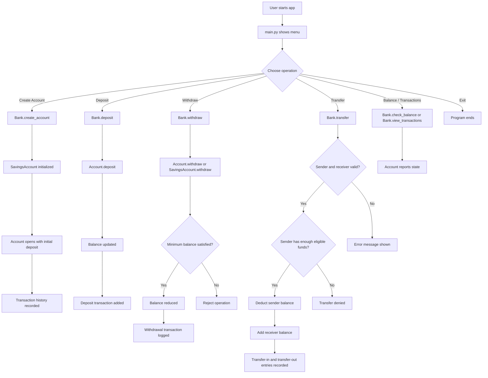

# Banking System

A Python-based banking management system built to demonstrate core object-oriented programming principles in a realistic, CLI-driven workflow. The project models account creation, deposits, withdrawals, transfers, balance checks, and transaction history using simple in-memory data structures.

## Overview

This project is designed as a learning-focused banking application for practicing:

- Object-oriented design
- Encapsulation and data protection
- Inheritance and specialization
- Polymorphism via method overriding
- Abstract contracts using ABCs
- Real-world application flow in a console UI

The system is intentionally lightweight and stores accounts in memory only; there is no database or external service integration.

## Tech Stack

- Python 3
- Standard library only
- Console-based interface (no web frontend)

## Key Features

- Create a savings account with minimum balance enforcement
- Deposit funds into an account
- Withdraw funds while respecting savings rules
- Transfer funds between accounts
- Check account balances
- View the transaction history of any account
- Maintain account numbers automatically
- Store timestamps for each transaction

## Project Structure

```text
banking-system/
├── account.py            # Base account abstraction and shared account logic
├── savings_account.py    # SavingsAccount with minimum-balance rules
├── transaction.py        # Transaction model with timestamp metadata
├── bank.py               # Bank controller that manages all accounts
├── helpers.py            # Input validation and menu utilities
├── main.py               # Entry point for the CLI application
├── banking_system.py     # Alternative/self-contained banking implementation
├── README.md             # Project documentation
└── .gitignore            # Git ignore file if present
```

## Core Components

### 1. Account

The [account.py](account.py) file defines the base `Account` class, which acts as the foundation for all account operations.

Responsibilities:

- Store an account number and owner name
- Manage the account balance
- Record transaction history
- Support deposit and withdrawal logic
- Expose safe getter methods for private values

### 2. SavingsAccount

The [savings_account.py](savings_account.py) file extends `Account` by adding a minimum balance requirement.

It demonstrates:

- Inheritance: gaining the base behavior of `Account`
- Polymorphism: overriding `withdraw()` to enforce a savings-specific rule

### 3. Transaction

The [transaction.py](transaction.py) file defines a `Transaction` model with:

- transaction type
- amount
- description
- timestamp

This makes auditing and viewing historical account activity straightforward.

### 4. Bank

The [bank.py](bank.py) file acts as the central controller.

Responsibilities:

- Maintain the dictionary of all customer accounts
- Generate unique account numbers
- Create accounts
- Find accounts by number
- Perform deposits, withdrawals, and transfers
- Validate transfer eligibility
- Delegate balance and transaction reporting

### 5. Main CLI

The [main.py](main.py) file provides the interactive menu that drives the system.

Available actions:

1. Create account
2. Deposit money
3. Withdraw money
4. Transfer money
5. Check balance
6. View all transactions
7. Exit

## OOP Principles Demonstrated

### Abstraction

The `BankOperations` abstract base class defines the required contract for bank accounts without implementing the behavior.

This makes the interface consistent across account types and enforces a base standard for all derived classes.

### Encapsulation

The account balance and account number are stored privately and protected via methods such as `get_balance()` and `_set_balance()`.

This ensures internal state is not changed accidentally from outside the object.

### Inheritance

`SavingsAccount` inherits from `Account`, reusing all common account logic such as:

- balance management
- transaction tracking
- deposit behavior
- reporting features

### Polymorphism

The method `withdraw()` behaves differently depending on the account type:

- base `Account` allows normal withdrawal if funds are sufficient
- `SavingsAccount` enforces a minimum balance rule before permitting a withdrawal

This is a classic example of runtime polymorphism in Python.

## Workflow and Process Flow

The user starts in the console menu, selects an operation, and the `Bank` service validates the request before interacting with the target account.



## Typical User Journey

A standard user flow looks like this:

1. Launch the app with Python.
2. Create an account with a name and opening deposit.
3. Deposit additional funds if needed.
4. Withdraw money while staying above the minimum balance.
5. Transfer funds to another account.
6. Review account balance and transaction history.
7. Exit the application.

## Runtime Behavior

The application keeps all data in memory while the program is running. This means:

- accounts are not saved to disk
- data is lost when the application exits
- the app is intentionally simple and educational

## Setup and Execution

### Prerequisites

- Python 3.8 or newer

### Run the program

```bash
python3 main.py
```

### Example session

```text
Welcome to Python National Bank!
Powered by Object-Oriented Programming

1. Create Account
2. Deposit Money
3. Withdraw Money
4. Transfer Money
5. Check Balance
6. View All Transactions
7. Exit
```

## Example Use Case

```text
Create account for Alice with $1000
Deposit $500
Withdraw $200
Transfer $300 to Bob's account
Check balance
View transaction list
```

The system logs every operation with timestamps and maintains a clear audit trail per account.

## Design Notes

This project is intentionally structured as a teaching example rather than a production-grade bank system. It demonstrates software engineering concepts without introducing external libraries, persistence, authentication, or database integration.

If expanded later, a production version might add:

- database persistence
- user authentication and authorization
- account types beyond savings
- transaction rollback logic
- interest calculations
- CSV/JSON export
- REST API or web interface

## Summary

This project brings together core object-oriented programming principles into a single, understandable banking workflow. It gives a clear illustration of how a small application can model real-world business logic using classes, encapsulation, inheritance, and polymorphism.

The system is suitable for:

- learning Python OOP
- practicing class design
- exploring object relationships
- demonstrating banking domain modeling

## License

This project is intended for educational and demonstration purposes.
